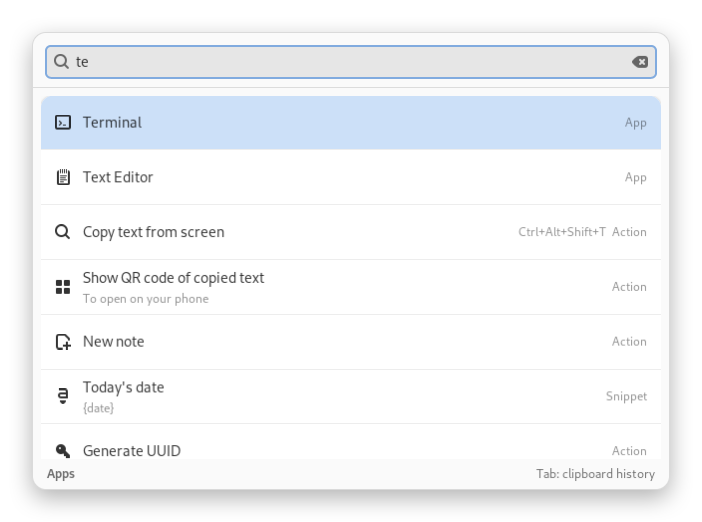
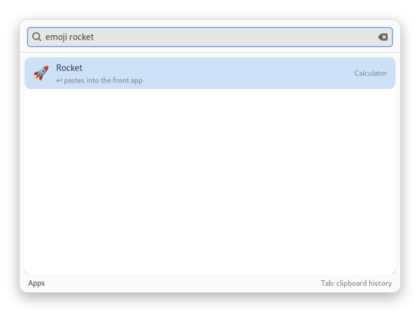
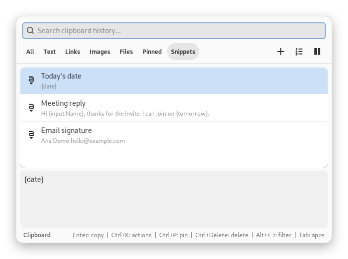
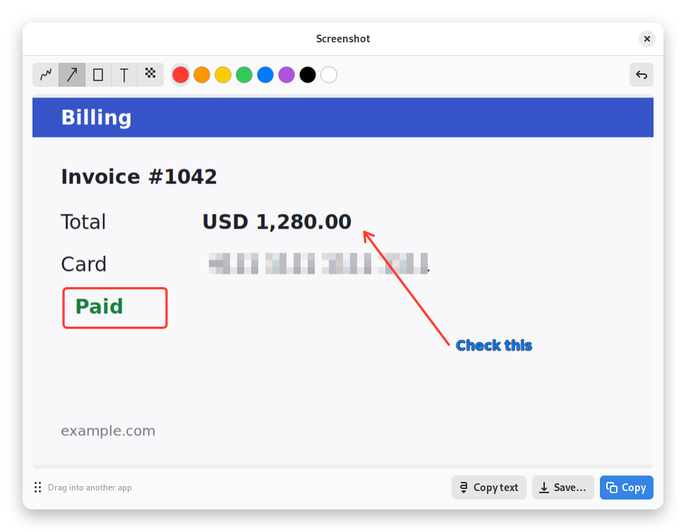
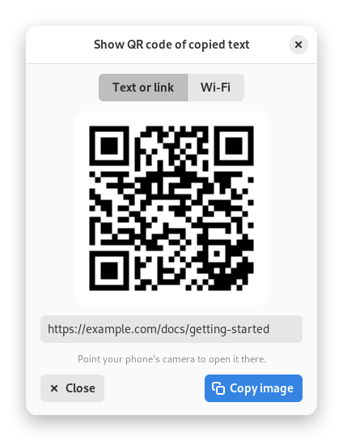
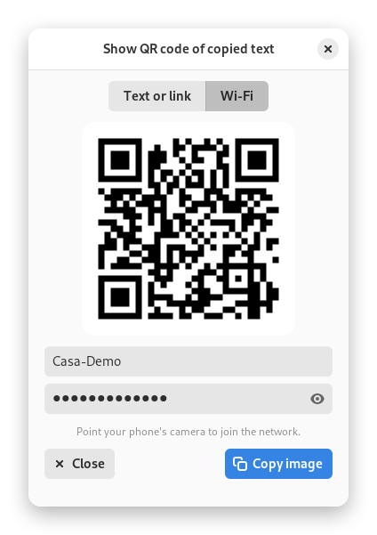
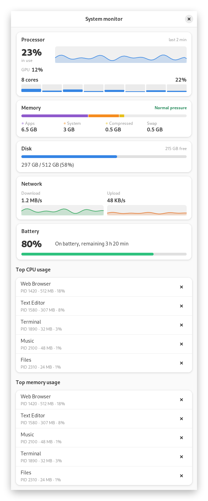
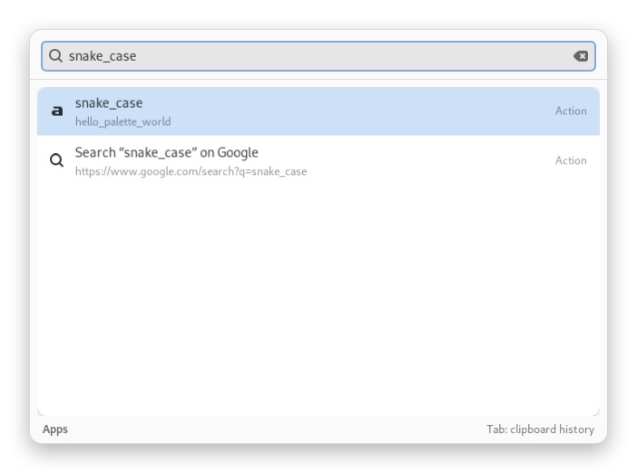

<p align="center">
  
</p>

<h1 align="center">Menew for Linux</h1>

<p align="center">
  <b>Your command palette and clipboard history, native on Linux.</b><br>
  Command palette · Calculator and conversions · Clipboard history · Notes · Screenshots and QR codes · System monitor · Snippets · Timers and focus · Emoji · Script commands<br>
  Free, open source, native. No account, no telemetry.
</p>

<p align="center">
  
  
  
  <a href="https://github.com/Quost/menew-linux/actions/workflows/ci.yml"></a>
  <a href="LICENSE"></a>
  <a href="https://github.com/Quost/menew-linux/stargazers"></a>
  <!-- Add the release badge when the first release is out:
  <a href="https://github.com/Quost/menew-linux/releases/latest"></a>
  -->
</p>

<p align="center">
  <a href="https://menew.pururucos.com.br/linux?ref=github"><b>Website</b></a> ·
  <a href="https://github.com/Quost/menew-linux/releases"><b>Download</b></a> (early preview) ·
  <a href="CONTRIBUTING.md"><b>Contribute</b></a> ·
  <a href="https://github.com/Quost/menew"><b>Mac app</b></a>
</p>

<p align="center">
  <picture>
    <source media="(prefers-color-scheme: dark)" srcset="docs/assets/clipboard-dark.png">
    
  </picture>
</p>

> **Status: early preview ([0.1.0-alpha.3](https://github.com/Quost/menew-linux/releases), for testers).** Menew for Linux is the port of [Menew for Mac](https://github.com/Quost/menew), and only part of the Mac app exists here so far: the command palette, the clipboard history, notes, screenshots, text from the screen and QR codes, and the system monitor. The first release will come when the core of the Mac app is ported. [docs/parity.md](docs/parity.md) lists every Mac feature and its Linux status. Everything described below works today, on headless GNOME Shell 46 and KWin 5.27 sessions; it has not been tested on a real desktop yet.

## Highlights

### ⌨️ Command palette: <kbd>Ctrl</kbd> <kbd>Alt</kbd> <kbd>Space</kbd>

<p align="center">
  <picture>
    <source media="(prefers-color-scheme: dark)" srcset="docs/assets/palette-apps-dark.png">
    
  </picture>
</p>

One box for apps, Menew actions and quick answers. Type to search; <kbd>Ctrl</kbd> <kbd>1</kbd> to <kbd>9</kbd> run the Nth result and your **recent picks come first**. It does math (`12*7.5`, `20% of 340`), **converts units** (`5 km to mi`, `72 f to c`), **time zones** (`3pm ny to lisbon`) and currencies (`100 usd to brl`, fetched only when you press <kbd>Enter</kbd>), transforms the copied text with a live preview, and finds **emoji** (`emoji rocket`).

<p align="center">
  <picture>
    <source media="(prefers-color-scheme: dark)" srcset="docs/assets/palette-conversion-dark.png">
    
  </picture>
  <picture>
    <source media="(prefers-color-scheme: dark)" srcset="docs/assets/palette-emoji-dark.png">
    
  </picture>
</p>

### 📋 Clipboard history: <kbd>Ctrl</kbd> <kbd>Alt</kbd> <kbd>V</kbd>

Text, links, images and files with instant search, filters, pins and a preview. <kbd>Enter</kbd> copies (and pastes, if you allow it), <kbd>Ctrl</kbd> <kbd>P</kbd> pins, <kbd>Ctrl</kbd> <kbd>Delete</kbd> deletes. Passwords from password managers are never saved, and you can pause the capture. Details are in the list below.

<p align="center">
  <picture>
    <source media="(prefers-color-scheme: dark)" srcset="docs/assets/clipboard-images-dark.png">
    
  </picture>
  <picture>
    <source media="(prefers-color-scheme: dark)" srcset="docs/assets/clipboard-snippets-dark.png">
    
  </picture>
</p>

### 📝 Notes: `menew notes`

Many notes with `#tags`, search and Markdown (headings, lists, checklists you can tick, quotes, code, bold, italic, links), in the same three kinds as the Mac: **normal**, **protected** (the content goes to your keyring, GNOME Keyring or KWallet, and opening it asks for your password through polkit) and **passwords** (name and value rows, hidden values, an eye to show and a copy button). A copied password is marked as confidential, never enters the history and is cleared after 30 seconds. The clipboard has a **Passwords** filter: <kbd>Enter</kbd> pastes the password, <kbd>Alt</kbd> <kbd>Enter</kbd> the username. Notes also show up in the palette.

### 📸 Screenshots: <kbd>Ctrl</kbd> <kbd>Alt</kbd> <kbd>Shift</kbd> <kbd>S</kbd>

<p align="center">
  <picture>
    <source media="(prefers-color-scheme: dark)" srcset="docs/assets/capture-editor-dark.png">
    
  </picture>
</p>

Capture an area, a window or the whole screen (Menew asks the screenshot portal, so GNOME and KDE show their own picker), then **annotate** it with a pen, arrows, rectangles and text, **blur** sensitive data (the pixels are really pixelated, not just covered), undo, and **copy** it, **save** it (to your Desktop, as `Screenshot 2026-11-17 10.30.15.png`) or **drag** it into another app. **Copy text** reads the text in the capture. <kbd>Ctrl</kbd> <kbd>Alt</kbd> <kbd>Shift</kbd> <kbd>T</kbd> copies the text of any area of the screen (with `tesseract`, on your computer). **QR codes**: read one from the screen (the content is copied, **links never open by themselves**) or show the QR code of the copied text, a link or your Wi-Fi so your phone can open or join it. The same things are in the palette (`screenshot`, `qr`), in the tray and in `menew capture`, `menew capture-text`.

<p align="center">
  <picture>
    <source media="(prefers-color-scheme: dark)" srcset="docs/assets/qr-code-dark.png">
    
  </picture>
  <picture>
    <source media="(prefers-color-scheme: dark)" srcset="docs/assets/qr-wifi-dark.png">
    
  </picture>
</p>

### 📊 System monitor: `menew monitor`

<p align="center">
  <picture>
    <source media="(prefers-color-scheme: dark)" srcset="docs/assets/monitor-dark.png">
    
  </picture>
</p>

CPU with a graph of the last 2 minutes, each core, the GPU where the driver reports it (AMD), **memory** split into apps, system and compressed with swap and a pressure badge, disk space, network speed with graphs, the battery with the time left and the **top processes by CPU and by memory**. Quit one with a click (SIGTERM); if it ignores that, a separate **Force Quit** button appears. Only your own processes are listed: the system and other users' are never offered. It opens from the tray, the palette ("system monitor") and `menew monitor`, and it reads the machine only while the window is open.

To show metrics in the tray (CPU, memory, network, disk, battery, a CPU graph), put them in `~/.config/menew/config.json` until the settings window arrives: `{"monitor_tray_items": ["cpu", "ram", "net"]}`. KDE Plasma shows them as text in the panel; GNOME's AppIndicator shows only the icon, so there they are in the tooltip. History, temperatures, battery health and alerts are not here yet.

## Everything else

<details>
<summary>🧮 <b>Math, units and currencies</b>: <code>12*7.5</code>, <code>20% of 340</code>, <code>2(3+4)</code>, <code>sqrt 16</code>, <code>5 km to mi</code>, <code>72 f to c</code></summary>

Decimal comma or point (`1,5 gb em mb`), and the connectors in five languages (`20% de 340`, `20% von 340`, `5 km em mi`, `nach`, `en`, `->`). Currencies use the European Central Bank rate through `api.frankfurter.app`, **only when you press Enter** on the result (see Privacy).

</details>

<details>
<summary>🕒 <b>Time zones</b>: <code>3pm ny to lisbon</code>, <code>time in Tokyo</code>, a pasted Unix timestamp</summary>

`15h em Lisboa`, `hora em Tóquio`, or just a city (`lisboa`). A pasted Unix timestamp (`1793400000`) shows its date; <kbd>Enter</kbd> copies the ISO date.

</details>

<details>
<summary>🔤 <b>Text transforms</b>: UPPERCASE, snake_case, JSON, Base64, JWT and more, on the copied text</summary>

UPPERCASE, lowercase, Title Case, Sentence case, remove accents or extra spaces, sort, reverse or dedupe lines, format or minify JSON, Base64 and URL encode and decode, count characters and words, camelCase, snake_case, kebab-case and decode a JWT, with a live preview.

<p align="center">
  <picture>
    <source media="(prefers-color-scheme: dark)" srcset="docs/assets/palette-transform-dark.png">
    
  </picture>
</p>

</details>

<details>
<summary>🔗 <b>Quick links</b>: <code>g coffee</code>, <code>gh menew</code>, <code>maps paulista</code>, your own</summary>

`yt ...`, `wiki ...`, `ddg ...`, plus your own in `~/.config/menew/config.json` (`jira ABC-123` with `https://company.atlassian.net/browse/{q}`). A typed address like `github.com/quost` opens directly. They open in your browser; Menew does not contact those sites.

</details>

<details>
<summary>⏱️ <b>Timers, alarms and focus</b>: <code>timer 10m tea</code>, <code>alarm 7:30 meeting</code>, <code>focus 50</code></summary>

The countdown shows in the tray (its title and tooltip) and at the end you get a notification and a sound. **Focus** starts 25 minutes (or `focus 50`), has **+5 minutes**, stop, and a 5 minute break at the end. Timers live only in memory: quitting Menew cancels them.

</details>

<details>
<summary>📜 <b>Script commands</b>: every script in a folder becomes a command</summary>

Every file in `~/.local/share/menew/scripts` (shell, Python, Node, Ruby) becomes a command; Raycast script headers (title, icon, mode, argument) work as they are. "Open scripts folder" creates it with an example. Scripts only run when you pick them.

</details>

<details>
<summary>📋 <b>Clipboard details</b>: filters, smart actions, OCR, paste queue, snippets, pause</summary>

- Pinned entries first, then the most recent, each with a one-line preview and a relative age.
- **Images and files** are kept too (images as files in `~/.local/share/menew/clipboard/`), with a thumbnail and a preview pane. Filters (All, Text, Links, Images, Files, Pinned, Snippets) with <kbd>Alt</kbd> <kbd>←</kbd>/<kbd>→</kbd>. The text inside copied images is read with `tesseract` on your computer, so search finds it.
- <kbd>Ctrl</kbd> <kbd>K</kbd> (or right click) opens the actions of the entry: paste, copy only, add to the paste queue, pin, **smart actions** (call, WhatsApp, maps, write an e-mail, track a package, copy a color as HEX/RGB/HSL, join a meeting), copy the text of an image, show the file, delete.
- **Pause** the capture for 15 minutes, 1 hour or until you resume: nothing is read while paused. Apps listed in `clipboard_ignored_apps` (`config.json`) are skipped on GNOME.
- **Paste queue**: turn it on, copy several things, then run **Paste next** (<kbd>Ctrl</kbd> <kbd>Alt</kbd> <kbd>N</kbd>, `menew paste-next`, the tray or the palette) once per item.
- **Snippets** with `{date}`, `{time}`, `{weekday}`, `{tomorrow}`, `{clipboard}`, `{cursor}` and `{input:Name}`, in the palette and in the Snippets filter.
- If `/dev/uinput` is writable, Menew also presses <kbd>Ctrl</kbd> <kbd>V</kbd> in the app you came from. Otherwise it only copies and shows "Copied. Press Ctrl+V to paste".

</details>

<details>
<summary>🪟 <b>Windows and quick actions</b>: <code>window left</code>, <code>mute</code>, <code>dark mode</code>, <code>awake 2h</code>, <code>port 3000</code></summary>

- **Window snapping** with the Mac's 17 positions (halves, corners, thirds, two thirds, center, almost full, fill, next display) from the palette, <kbd>Ctrl</kbd> <kbd>Alt</kbd> <kbd>Shift</kbd> <kbd>←</kbd>/<kbd>→</kbd>/<kbd>↑</kbd>/<kbd>↓</kbd> and <kbd>Ctrl</kbd> <kbd>Alt</kbd> <kbd>Enter</kbd>. KDE Plasma moves the window through a KWin script; GNOME needs the bundled Menew extension (version 2: log out and in after updating it).
- **Microphone and sound**: mute or unmute (<kbd>Ctrl</kbd> <kbd>Alt</kbd> <kbd>M</kbd> for the mic), and switch the output or input device (`pactl`, PipeWire or PulseAudio).
- **Dark mode**, **keep awake** (`awake 2h`, `acordado 90m`, or until you turn it off), **lock screen**, **empty trash** (asks first), **color picker** (the `#RRGGBB` is copied), **plain text clipboard**, **eject disks**, **brightness** (`brightness 40`, also external displays with `ddcutil`).
- **Quit apps**: `quit firefox`, `kill firefox` (force), "Quit all apps" skips the apps in `never_quit` (`config.json`). Wayland has no way to ask an app to close its windows, so Menew sends it a signal.
- **Ports in use**: `port 3000` shows the server listening there and <kbd>Enter</kbd> stops it.
- Every action also runs from a terminal or a custom shortcut: `menew run qa.mic`, `menew run win.left`, `menew run note.new`.

</details>

<details>
<summary>🔔 <b>Tray icon and start at login</b></summary>

The tray has Open palette, Clipboard history, Clear history (keeps pinned entries), Start at login and Quit. **Start at login** is opt-in (off by default): it creates `~/.config/autostart/menew.desktop`, and unchecking it in the tray removes the file again.

</details>

<details>
<summary>🌍 <b>5 languages</b>: English, Português, Deutsch, Español and 中文</summary>

The language follows `LC_ALL` / `LANG`.

</details>

Not here yet (see [docs/parity.md](docs/parity.md)): Memory, recordings, pinning a screenshot on the screen, screen recording, scrolling capture, asking about the screen, on-device AI and agents. They are on the roadmap of the Mac app and will come to Linux as far as the platform allows.

## Install

Download from the [website](https://menew.pururucos.com.br/linux) or the [GitHub releases page](https://github.com/Quost/menew-linux/releases) and check the files with `SHA256SUMS` (`sha256sum -c SHA256SUMS --ignore-missing`).

**.deb** (Ubuntu 24.04+, Debian 13): double-click the file to install it with App Center (or GNOME Software), or in a terminal:

```bash
sudo apt install ./menew_<version>_amd64.deb
```

Then open **Menew** from the app grid. On the first start Menew sets itself up and shows a welcome window that says what it did:

- **Start at login** is turned on (switch it off there, in the tray or in the palette).
- **GNOME**: its clipboard extension is turned on. GNOME on Wayland loads extensions at login, so **log out and back in once**. On GNOME 45 to 47, which have no global shortcuts portal, the shortcuts are created in Settings › Keyboard › Custom Shortcuts.
- **KDE Plasma**: the shortcuts come from the system's portal, and the clipboard needs `wl-clipboard` (recommended by the .deb).

Open the welcome again with "Welcome and setup" in the palette or `menew welcome`. If App Center only spins when you double-click the .deb, update it (`sudo snap refresh snap-store`) or use the `apt` command above.

**AppImage** (any x86_64 distro):

```bash
chmod +x Menew-<version>-x86_64.AppImage
./Menew-<version>-x86_64.AppImage
```

GTK4 and libadwaita are bundled. The first start does the same setup; on GNOME the AppImage writes its extension to `~/.local/share/gnome-shell/extensions/`. The autostart entry points at the AppImage file, so keep it where it is.

**Build from source** (needs a Rust toolchain and the GTK4 and libadwaita development packages):

```bash
git clone https://github.com/Quost/menew-linux
cd menew-linux
cargo run -p menew -- open
```

## Keyboard shortcuts

| Shortcut | Action |
|---|---|
| <kbd>Ctrl</kbd> <kbd>Alt</kbd> <kbd>Space</kbd> | Open the command palette |
| <kbd>Ctrl</kbd> <kbd>Alt</kbd> <kbd>V</kbd> | Open clipboard history |
| <kbd>Ctrl</kbd> <kbd>Alt</kbd> <kbd>N</kbd> | Paste the next item of the paste queue |
| <kbd>Ctrl</kbd> <kbd>Alt</kbd> <kbd>Shift</kbd> <kbd>S</kbd> | Capture the screen and annotate it |
| <kbd>Ctrl</kbd> <kbd>Alt</kbd> <kbd>Shift</kbd> <kbd>T</kbd> | Copy the text of an area of the screen |
| <kbd>Ctrl</kbd> <kbd>Alt</kbd> <kbd>M</kbd> | Mute or unmute the microphone |
| <kbd>Ctrl</kbd> <kbd>Alt</kbd> <kbd>Shift</kbd> <kbd>←</kbd> <kbd>→</kbd> <kbd>↑</kbd> <kbd>↓</kbd> | Snap the window to that half |
| <kbd>Ctrl</kbd> <kbd>Alt</kbd> <kbd>Enter</kbd> | Make the window fill the screen |
| <kbd>Ctrl</kbd> <kbd>Alt</kbd> <kbd>J</kbd> | New note |
| <kbd>Ctrl</kbd> <kbd>Z</kbd> / <kbd>Ctrl</kbd> <kbd>S</kbd> / <kbd>Ctrl</kbd> <kbd>C</kbd> | In the editor: undo / save / copy |
| <kbd>Tab</kbd> | Switch between Apps and Clipboard in the palette |
| <kbd>↑</kbd> <kbd>↓</kbd> / <kbd>Enter</kbd> / <kbd>Esc</kbd> | Move / run or copy / close |
| <kbd>Ctrl</kbd> <kbd>1</kbd>…<kbd>9</kbd> | Run the Nth result |
| <kbd>Ctrl</kbd> <kbd>P</kbd> / <kbd>Ctrl</kbd> <kbd>Delete</kbd> | Pin / delete the selected clipboard entry |
| <kbd>Ctrl</kbd> <kbd>K</kbd> | Actions of the selected clipboard entry (also right click) |
| <kbd>Alt</kbd> <kbd>←</kbd> <kbd>→</kbd> | Previous / next clipboard filter |

The global shortcuts use the GlobalShortcuts portal, available on KDE Plasma and GNOME 48+. On GNOME 45 to 47 Menew creates them on its first start as custom shortcuts (Settings › Keyboard › Custom Shortcuts, named "Menew: ..."), where you can change them; the window snapping keys are left out there because GNOME uses them to move windows between workspaces (GNOME snaps with <kbd>Super</kbd> <kbd>←</kbd> <kbd>→</kbd>). The welcome window (`menew welcome`) has a button to create them later.

## Privacy

The app has **no telemetry, no analytics and no account**, and makes no network request you did not ask for, except the update check below (which you can switch off).

- The clipboard history is stored only in a local SQLite file (`~/.local/share/menew/clipboard.db`); images are files in `~/.local/share/menew/clipboard/`. Nothing is uploaded.
- The only network request is a currency rate, sent when you press <kbd>Enter</kbd> on a conversion like `100 usd to brl`: one HTTPS GET to `api.frankfurter.app` (European Central Bank data, the same provider the Mac app uses) with the two currency codes and nothing else, made with the system `curl`. Typing never sends anything; the rate is kept in memory for 6 hours.
- The second network request is the update check, the same idea as the Mac app's: on by default, switch it off with "Check for updates automatically" in the tray (or `"auto_update_check": false` in `~/.config/menew/config.json`). A few minutes after start and then every 24 hours Menew reads the list of releases of this repository from `api.github.com` and the `update.json` of the newest one with the system `curl`, and sends nothing but `User-Agent: Menew/<version>`: no identifier, no usage data. It never opens a window by itself: the tray icon gets a dot and a menu item "Update available". An update is installed only when you pick **Install and Relaunch**, and only after its size, SHA-256 and Ed25519 signature (key compiled into Menew) are checked; otherwise nothing is touched. `menew check-updates` does the check from a terminal. Nothing is requested in the screenshot mode.
- Copies flagged by password managers (`x-kde-passwordManagerHint`, `CONCEALED` and similar) are never read, whatever they hold (text, image or files). While the capture is paused the clipboard is not read at all.
- Reading the text of images runs `tesseract` locally; nothing is uploaded.
- **Screenshots** are taken by your system (the screenshot portal). A capture stays in memory: the file the system writes is read and **deleted right away**, and the picture handed to `tesseract` is a file in your private runtime folder (`$XDG_RUNTIME_DIR/menew`) that is deleted as soon as it was read. A capture only leaves Menew when you copy it, save it or drag it. Copying it puts it in the clipboard history like any copied image. Reading a QR code only copies its text: **Menew never opens a link from a QR code**.
- The system monitor reads `/proc` and `/sys` locally, only while its window is open or while you chose tray metrics (`monitor_tray_items`, off by default), and sends nothing anywhere. Quitting a process sends it a signal (SIGTERM, or SIGKILL when you press Force Quit).
- Your recent picks are stored in `~/.local/share/menew/recents.json` (item ids only, never copied text); scripts, quick links and world clocks live in `~/.local/share/menew/scripts` and `~/.config/menew/config.json`.
- "Clear history" in the tray deletes every unpinned entry and the image files that go with them.
- Notes live in `~/.local/share/menew/notes/notes.json` (the same format as the Mac). **Normal notes are plain text in that file.** Protected and password notes keep only their title there: the rest is in the Secret Service of your keyring (`application=app.menew.Menew`), never in a plain file. Opening one asks for your password through polkit; where the polkit policy is not installed (AppImage) or there is no authentication agent, the keyring unlocked at login is the only protection, and the notes window says so.
- Quick actions and window snapping run your desktop's own tools locally (`pactl`, `gsettings`, `systemd-inhibit`, `loginctl`, `gio`, `lsblk`, `udisksctl`, `ddcutil`, a KWin script or the Menew GNOME extension) and send nothing anywhere. The color picker goes through the screenshot portal and keeps only the color.
- The first start changes only local settings, and says so in the welcome window: the autostart entry `~/.config/autostart/menew.desktop`, on GNOME the list of enabled extensions (`org.gnome.shell enabled-extensions`) and, on GNOME 45 to 47, custom shortcuts named "Menew: ..." (`org.gnome.settings-daemon.plugins.media-keys`). Each can be undone in the welcome window, the tray or GNOME Settings.
- The optional paste simulation only writes a <kbd>Ctrl</kbd> <kbd>V</kbd> key press to `/dev/uinput`; it never reads keyboard input.

## FAQ

**Is Menew for Linux really free?**  
Yes. It is free and open source under the GPL-3.0 license: no ads, no subscription, no paid tier. If it helps you, you can buy the author a coffee, but nothing in the app asks for it.

**Which desktops does it run on?**  
GNOME and KDE Plasma on Wayland. X11 is best effort only. So far it was tested on headless GNOME Shell 46 and KWin 5.27 sessions (Ubuntu 24.04), not on a real desktop.

**Why does GNOME need an extension for the clipboard?**  
GNOME's compositor (Mutter) does not let background apps read the clipboard on Wayland. On GNOME the clipboard history needs the Menew GNOME Shell extension, which sends copies to Menew over D-Bus. The .deb installs it in `/usr/share/gnome-shell/extensions/menew-bridge@pururucos.com.br/` and Menew turns it on by itself on its first start (in `org.gnome.shell enabled-extensions`); the AppImage writes it to `~/.local/share/gnome-shell/extensions/` first. GNOME on Wayland only loads extensions at login, so log out and back in once. If it is still off, run `gnome-extensions enable menew-bridge@pururucos.com.br`. Whoever had turned on its old name (`menew-bridge@menew.web.app`) gets the new one by itself. On KDE Plasma nothing extra is needed.

**I do not see the tray icon on GNOME.**  
GNOME has no tray by default. Install the AppIndicator extension (`sudo apt install gnome-shell-extension-appindicator` on Ubuntu and Debian, `sudo dnf install gnome-shell-extension-appindicator` on Fedora) and enable it with `gnome-extensions enable appindicatorsupport@rgcjonas.gmail.com`. KDE Plasma shows the tray icon out of the box.

**The shortcut does nothing.**  
Global shortcuts need the GlobalShortcuts portal (KDE Plasma, GNOME 48+). On GNOME 45 to 47 Menew creates custom shortcuts on its first start; if they are missing, open `menew welcome` and press "Create the shortcuts", or create them yourself in Settings › Keyboard › Custom Shortcuts with the commands `menew toggle`, `menew clipboard`, `menew paste-next`, `menew capture` and `menew capture-text`.

**Can Menew paste for me?**  
By default Menew copies the entry and shows "Copied. Press Ctrl+V to paste". To let it press <kbd>Ctrl</kbd> <kbd>V</kbd> for you it needs write access to `/dev/uinput`. The packages **do not** install this; the rule is in `data/60-menew-uinput.rules`:

```bash
sudo cp data/60-menew-uinput.rules /etc/udev/rules.d/
sudo udevadm control --reload && sudo udevadm trigger /dev/uinput
sudo usermod -aG input "$USER"    # then log out and in
```

Security risk: any program running as a member of the `input` group can then inject keystrokes into your session. Only enable it if you accept that. To undo it, remove the rule file and the group membership (`sudo gpasswd -d "$USER" input`). You can also set `"paste_mode": "copy-only"` in `~/.config/menew/config.json` to never inject.

**Is there a Flatpak or Snap?**  
Not planned. A sandbox blocks the background clipboard capture and the window activation Menew needs. The first packages are the .deb and the AppImage, then the AUR.

**Does it work on X11?**  
It is built for Wayland. X11 is best effort and not tested.

**Where is the Mac app?**  
[github.com/Quost/menew](https://github.com/Quost/menew). Menew for Linux is its port; the two projects have separate repositories and release cycles.

## Feedback

Found a bug or have an idea? [Open an issue](https://github.com/Quost/menew-linux/issues/new/choose) with your distribution, desktop (GNOME or KDE, Wayland or X11) and `menew --version`.

## Contributing

Pull requests are very welcome. See [CONTRIBUTING.md](CONTRIBUTING.md) for how the project is organized, how to build and test it, and how to regenerate the screenshots.

## Support

Menew is free and made in spare time. If it saves you a few minutes a day, a ⭐ on GitHub, a sponsorship or a coffee goes a long way.

<a href="https://github.com/sponsors/Quost"></a>
<a href="https://buymeacoffee.com/quost"></a>

## License

[GPL-3.0](LICENSE) © Matheus Quost.

The name “Menew”, the icon and the website are not part of the license: a fork needs its own name and icon. See [TRADEMARK.md](TRADEMARK.md).
