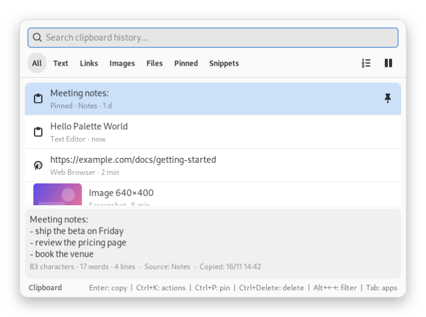
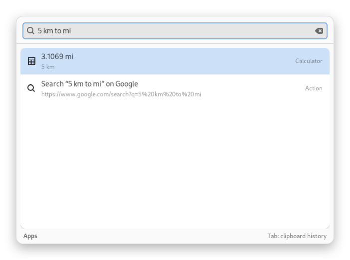
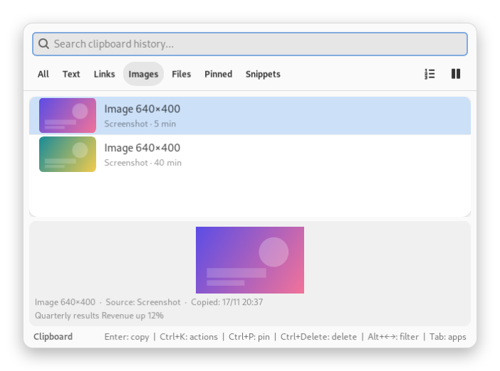

<p align="center">
  
</p>

<h1 align="center">Menew for Linux</h1>

<p align="center">
  <b>Your command palette and clipboard history, native on Linux.</b><br>
  Command palette · Calculator and conversions · Clipboard history · Snippets · Timers and focus · Emoji · Script commands<br>
  Free, open source, native. No account, no telemetry.
</p>

<p align="center">
  
  
  
  <a href="https://github.com/Quost/menew-linux/actions/workflows/ci.yml"></a>
  <a href="LICENSE"></a>
  <a href="https://github.com/Quost/menew-linux/stargazers"></a>
  <!-- Add the release badge when the first release is out:
  <a href="https://github.com/Quost/menew-linux/releases/latest"></a>
  -->
</p>

<p align="center">
  <a href="https://menew.web.app/?ref=github"><b>Website</b></a> ·
  <a href="https://github.com/Quost/menew-linux/releases"><b>Download</b></a> (no release yet) ·
  <a href="CONTRIBUTING.md"><b>Contribute</b></a> ·
  <a href="https://github.com/Quost/menew"><b>Mac app</b></a>
</p>

<p align="center">
  <picture>
    <source media="(prefers-color-scheme: dark)" srcset="docs/assets/clipboard-dark.png">
    
  </picture>
</p>

> **Status: not released yet.** Menew for Linux is the port of [Menew for Mac](https://github.com/Quost/menew), and only part of the Mac app exists here so far: the command palette and the clipboard history. The first release will come when the core of the Mac app is ported. [docs/parity.md](docs/parity.md) lists every Mac feature and its Linux status. Everything described below works today, on headless GNOME Shell 46 and KWin 5.27 sessions; it has not been tested on a real desktop yet.

## Highlights

### ⌨️ Command palette: <kbd>Ctrl</kbd> <kbd>Alt</kbd> <kbd>Space</kbd>

<p align="center">
  <picture>
    <source media="(prefers-color-scheme: dark)" srcset="docs/assets/palette-apps-dark.png">
    
  </picture>
</p>

One box for apps, Menew actions and quick answers. Type to search; <kbd>Ctrl</kbd> <kbd>1</kbd> to <kbd>9</kbd> run the Nth result and your **recent picks come first**. It does math (`12*7.5`, `20% of 340`), **converts units** (`5 km to mi`, `72 f to c`), **time zones** (`3pm ny to lisbon`) and currencies (`100 usd to brl`, fetched only when you press <kbd>Enter</kbd>), transforms the copied text with a live preview, and finds **emoji** (`emoji rocket`).

<p align="center">
  <picture>
    <source media="(prefers-color-scheme: dark)" srcset="docs/assets/palette-conversion-dark.png">
    
  </picture>
  <picture>
    <source media="(prefers-color-scheme: dark)" srcset="docs/assets/palette-emoji-dark.png">
    
  </picture>
</p>

### 📋 Clipboard history: <kbd>Ctrl</kbd> <kbd>Alt</kbd> <kbd>V</kbd>

Text, links, images and files with instant search, filters, pins and a preview. <kbd>Enter</kbd> copies (and pastes, if you allow it), <kbd>Ctrl</kbd> <kbd>P</kbd> pins, <kbd>Ctrl</kbd> <kbd>Delete</kbd> deletes. Passwords from password managers are never saved, and you can pause the capture. Details are in the list below.

<p align="center">
  <picture>
    <source media="(prefers-color-scheme: dark)" srcset="docs/assets/clipboard-images-dark.png">
    
  </picture>
  <picture>
    <source media="(prefers-color-scheme: dark)" srcset="docs/assets/clipboard-snippets-dark.png">
    
  </picture>
</p>

## Everything else

<details>
<summary>🧮 <b>Math, units and currencies</b>: <code>12*7.5</code>, <code>20% of 340</code>, <code>2(3+4)</code>, <code>sqrt 16</code>, <code>5 km to mi</code>, <code>72 f to c</code></summary>

Decimal comma or point (`1,5 gb em mb`), and the connectors in five languages (`20% de 340`, `20% von 340`, `5 km em mi`, `nach`, `en`, `->`). Currencies use the European Central Bank rate through `api.frankfurter.app`, **only when you press Enter** on the result (see Privacy).

</details>

<details>
<summary>🕒 <b>Time zones</b>: <code>3pm ny to lisbon</code>, <code>time in Tokyo</code>, a pasted Unix timestamp</summary>

`15h em Lisboa`, `hora em Tóquio`, or just a city (`lisboa`). A pasted Unix timestamp (`1793400000`) shows its date; <kbd>Enter</kbd> copies the ISO date.

</details>

<details>
<summary>🔤 <b>Text transforms</b>: UPPERCASE, snake_case, JSON, Base64, JWT and more, on the copied text</summary>

UPPERCASE, lowercase, Title Case, Sentence case, remove accents or extra spaces, sort, reverse or dedupe lines, format or minify JSON, Base64 and URL encode and decode, count characters and words, camelCase, snake_case, kebab-case and decode a JWT, with a live preview.

<p align="center">
  <picture>
    <source media="(prefers-color-scheme: dark)" srcset="docs/assets/palette-transform-dark.png">
    
  </picture>
</p>

</details>

<details>
<summary>🔗 <b>Quick links</b>: <code>g coffee</code>, <code>gh menew</code>, <code>maps paulista</code>, your own</summary>

`yt ...`, `wiki ...`, `ddg ...`, plus your own in `~/.config/menew/config.json` (`jira ABC-123` with `https://company.atlassian.net/browse/{q}`). A typed address like `github.com/quost` opens directly. They open in your browser; Menew does not contact those sites.

</details>

<details>
<summary>⏱️ <b>Timers, alarms and focus</b>: <code>timer 10m tea</code>, <code>alarm 7:30 meeting</code>, <code>focus 50</code></summary>

The countdown shows in the tray (its title and tooltip) and at the end you get a notification and a sound. **Focus** starts 25 minutes (or `focus 50`), has **+5 minutes**, stop, and a 5 minute break at the end. Timers live only in memory: quitting Menew cancels them.

</details>

<details>
<summary>📜 <b>Script commands</b>: every script in a folder becomes a command</summary>

Every file in `~/.local/share/menew/scripts` (shell, Python, Node, Ruby) becomes a command; Raycast script headers (title, icon, mode, argument) work as they are. "Open scripts folder" creates it with an example. Scripts only run when you pick them.

</details>

<details>
<summary>📋 <b>Clipboard details</b>: filters, smart actions, OCR, paste queue, snippets, pause</summary>

- Pinned entries first, then the most recent, each with a one-line preview and a relative age.
- **Images and files** are kept too (images as files in `~/.local/share/menew/clipboard/`), with a thumbnail and a preview pane. Filters (All, Text, Links, Images, Files, Pinned, Snippets) with <kbd>Alt</kbd> <kbd>←</kbd>/<kbd>→</kbd>. The text inside copied images is read with `tesseract` on your computer, so search finds it.
- <kbd>Ctrl</kbd> <kbd>K</kbd> (or right click) opens the actions of the entry: paste, copy only, add to the paste queue, pin, **smart actions** (call, WhatsApp, maps, write an e-mail, track a package, copy a color as HEX/RGB/HSL, join a meeting), copy the text of an image, show the file, delete.
- **Pause** the capture for 15 minutes, 1 hour or until you resume: nothing is read while paused. Apps listed in `clipboard_ignored_apps` (`config.json`) are skipped on GNOME.
- **Paste queue**: turn it on, copy several things, then run **Paste next** (<kbd>Ctrl</kbd> <kbd>Alt</kbd> <kbd>N</kbd>, `menew paste-next`, the tray or the palette) once per item.
- **Snippets** with `{date}`, `{time}`, `{weekday}`, `{tomorrow}`, `{clipboard}`, `{cursor}` and `{input:Name}`, in the palette and in the Snippets filter.
- If `/dev/uinput` is writable, Menew also presses <kbd>Ctrl</kbd> <kbd>V</kbd> in the app you came from. Otherwise it only copies and shows "Copied. Press Ctrl+V to paste".

</details>

<details>
<summary>🔔 <b>Tray icon and start at login</b></summary>

The tray has Open palette, Clipboard history, Clear history (keeps pinned entries), Start at login and Quit. **Start at login** is opt-in (off by default): it creates `~/.config/autostart/menew.desktop`, and unchecking it in the tray removes the file again.

</details>

<details>
<summary>🌍 <b>5 languages</b>: English, Português, Deutsch, Español and 中文</summary>

The language follows `LC_ALL` / `LANG`.

</details>

Not here yet (see [docs/parity.md](docs/parity.md)): Memory, recordings, notes, screenshots, window management, system monitor, on-device AI and agents. They are on the roadmap of the Mac app and will come to Linux as far as the platform allows.

## Install

There is no release yet. Once there is, the files will be on the [GitHub releases page](https://github.com/Quost/menew-linux/releases); check them with `SHA256SUMS`. Until then, build from source (see [CONTRIBUTING.md](CONTRIBUTING.md)) or build the packages yourself (`cargo deb -p menew`, `scripts/build-appimage.sh`).

```bash
sha256sum -c SHA256SUMS
```

**.deb** (Ubuntu 24.04+, Debian 13):

```bash
sudo apt install ./menew_<version>_amd64.deb
menew --version   # prints the version
menew             # starts hidden in the tray; open the palette with Ctrl+Alt+Space
```

`wl-clipboard` is recommended (used for clipboard history on KDE).

**AppImage** (any x86_64 distro):

```bash
chmod +x Menew-<version>-x86_64.AppImage
./Menew-<version>-x86_64.AppImage
```

GTK4 and libadwaita are bundled. If you enable "Start at login" in the tray, the autostart entry points at the AppImage file, so keep it where it is. The AppImage does not install the GNOME extension (see the FAQ).

**Build from source** (needs a Rust toolchain and the GTK4 and libadwaita development packages):

```bash
git clone https://github.com/Quost/menew-linux
cd menew-linux
cargo run -p menew
```

## Keyboard shortcuts

| Shortcut | Action |
|---|---|
| <kbd>Ctrl</kbd> <kbd>Alt</kbd> <kbd>Space</kbd> | Open the command palette |
| <kbd>Ctrl</kbd> <kbd>Alt</kbd> <kbd>V</kbd> | Open clipboard history |
| <kbd>Ctrl</kbd> <kbd>Alt</kbd> <kbd>N</kbd> | Paste the next item of the paste queue |
| <kbd>Tab</kbd> | Switch between Apps and Clipboard in the palette |
| <kbd>↑</kbd> <kbd>↓</kbd> / <kbd>Enter</kbd> / <kbd>Esc</kbd> | Move / run or copy / close |
| <kbd>Ctrl</kbd> <kbd>1</kbd>…<kbd>9</kbd> | Run the Nth result |
| <kbd>Ctrl</kbd> <kbd>P</kbd> / <kbd>Ctrl</kbd> <kbd>Delete</kbd> | Pin / delete the selected clipboard entry |
| <kbd>Ctrl</kbd> <kbd>K</kbd> | Actions of the selected clipboard entry (also right click) |
| <kbd>Alt</kbd> <kbd>←</kbd> <kbd>→</kbd> | Previous / next clipboard filter |

The global shortcuts use the GlobalShortcuts portal, available on KDE Plasma and GNOME 48+. On GNOME 45-47 create two custom shortcuts in Settings (Keyboard, Custom Shortcuts) that run `menew toggle` and `menew clipboard`.

## Privacy

The app has **no telemetry, no analytics and no account**, and makes no network request you did not ask for.

- The clipboard history is stored only in a local SQLite file (`~/.local/share/menew/clipboard.db`); images are files in `~/.local/share/menew/clipboard/`. Nothing is uploaded.
- The only network request is a currency rate, sent when you press <kbd>Enter</kbd> on a conversion like `100 usd to brl`: one HTTPS GET to `api.frankfurter.app` (European Central Bank data, the same provider the Mac app uses) with the two currency codes and nothing else, made with the system `curl`. Typing never sends anything; the rate is kept in memory for 6 hours.
- Copies flagged by password managers (`x-kde-passwordManagerHint`, `CONCEALED` and similar) are never read, whatever they hold (text, image or files). While the capture is paused the clipboard is not read at all.
- Reading the text of images runs `tesseract` locally; nothing is uploaded.
- Your recent picks are stored in `~/.local/share/menew/recents.json` (item ids only, never copied text); scripts, quick links and world clocks live in `~/.local/share/menew/scripts` and `~/.config/menew/config.json`.
- "Clear history" in the tray deletes every unpinned entry and the image files that go with them.
- The optional paste simulation only writes a <kbd>Ctrl</kbd> <kbd>V</kbd> key press to `/dev/uinput`; it never reads keyboard input.

## FAQ

**Is Menew for Linux really free?**  
Yes. It is free and open source under the GPL-3.0 license: no ads, no subscription, no paid tier. If it helps you, you can buy the author a coffee, but nothing in the app asks for it.

**Which desktops does it run on?**  
GNOME and KDE Plasma on Wayland. X11 is best effort only. So far it was tested on headless GNOME Shell 46 and KWin 5.27 sessions (Ubuntu 24.04), not on a real desktop.

**Why does GNOME need an extension for the clipboard?**  
GNOME's compositor (Mutter) does not let background apps read the clipboard on Wayland. On GNOME the clipboard history needs the Menew GNOME Shell extension, which sends copies to Menew over D-Bus. The .deb installs it in `/usr/share/gnome-shell/extensions/menew-bridge@menew.web.app/` but **does not enable it**: run `gnome-extensions enable menew-bridge@menew.web.app`, then log out and in again (Wayland cannot reload GNOME Shell). With the AppImage, run `bash gnome-extension/install.sh` from a checkout and enable it the same way. On KDE Plasma nothing extra is needed.

**I do not see the tray icon on GNOME.**  
GNOME has no tray by default. Install the AppIndicator extension (`sudo apt install gnome-shell-extension-appindicator` on Ubuntu and Debian, `sudo dnf install gnome-shell-extension-appindicator` on Fedora) and enable it with `gnome-extensions enable appindicatorsupport@rgcjonas.gmail.com`. KDE Plasma shows the tray icon out of the box.

**The shortcut does nothing.**  
Global shortcuts need the GlobalShortcuts portal (KDE Plasma, GNOME 48+). On GNOME 45-47 create two custom shortcuts that run `menew toggle` and `menew clipboard`.

**Can Menew paste for me?**  
By default Menew copies the entry and shows "Copied. Press Ctrl+V to paste". To let it press <kbd>Ctrl</kbd> <kbd>V</kbd> for you it needs write access to `/dev/uinput`. The packages **do not** install this; the rule is in `data/60-menew-uinput.rules`:

```bash
sudo cp data/60-menew-uinput.rules /etc/udev/rules.d/
sudo udevadm control --reload && sudo udevadm trigger /dev/uinput
sudo usermod -aG input "$USER"    # then log out and in
```

Security risk: any program running as a member of the `input` group can then inject keystrokes into your session. Only enable it if you accept that. To undo it, remove the rule file and the group membership (`sudo gpasswd -d "$USER" input`). You can also set `"paste_mode": "copy-only"` in `~/.config/menew/config.json` to never inject.

**Is there a Flatpak or Snap?**  
Not planned. A sandbox blocks the background clipboard capture and the window activation Menew needs. The first packages are the .deb and the AppImage, then the AUR.

**Does it work on X11?**  
It is built for Wayland. X11 is best effort and not tested.

**Where is the Mac app?**  
[github.com/Quost/menew](https://github.com/Quost/menew). Menew for Linux is its port; the two projects have separate repositories and release cycles.

## Feedback

Found a bug or have an idea? [Open an issue](https://github.com/Quost/menew-linux/issues/new/choose) with your distribution, desktop (GNOME or KDE, Wayland or X11) and `menew --version`.

## Contributing

Pull requests are very welcome. See [CONTRIBUTING.md](CONTRIBUTING.md) for how the project is organized, how to build and test it, and how to regenerate the screenshots.

## Support

Menew is free and made in spare time. If it saves you a few minutes a day, a ⭐ on GitHub, a sponsorship or a coffee goes a long way.

<a href="https://github.com/sponsors/Quost"></a>
<a href="https://buymeacoffee.com/quost"></a>

## License

[GPL-3.0](LICENSE) © Matheus Quost.

The name “Menew”, the icon and the website are not part of the license: a fork needs its own name and icon. See [TRADEMARK.md](TRADEMARK.md).
